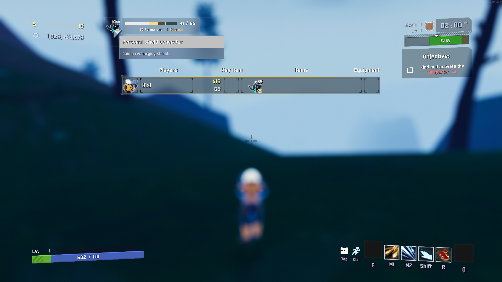
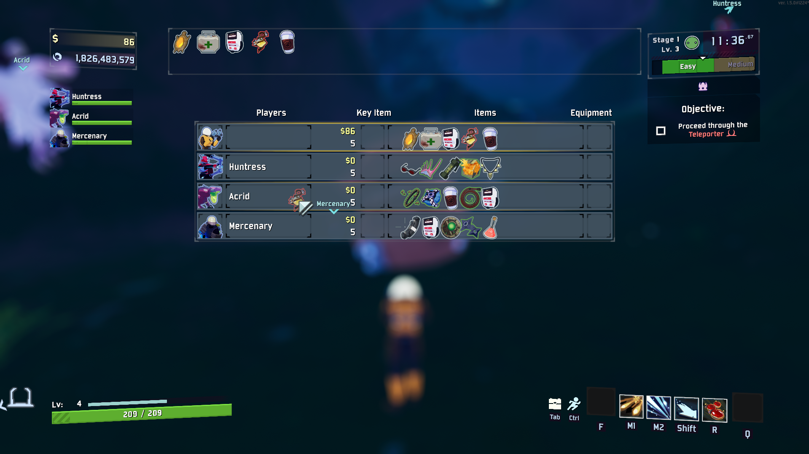
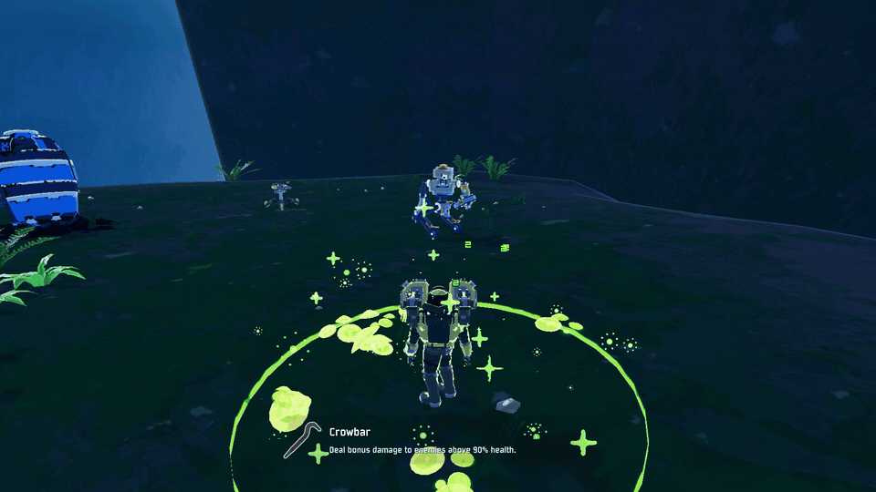
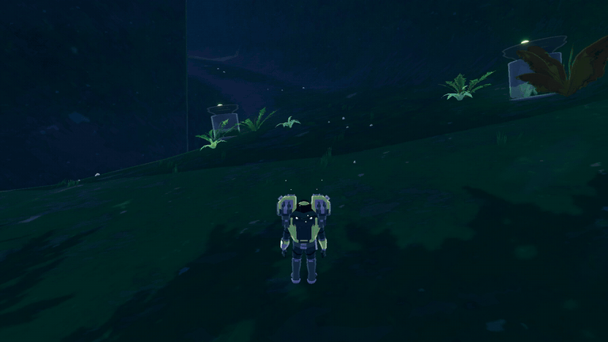

# Just Drop Items

Drop items or hand them to a teammate who needs them more: a survivor-specific item, a Wandering CHEF ingredient,
or an item your void item would corrupt. **Temporary** and **Ethereal** copies stay what they are, and the Recycler
can't be abused to reroll the same item forever.

**Who needs the mod**: the host, and every player who wants to drop or give items. Players without it can still join and
see ordinary pickups and flying items.

## Screenshots

 <em>The amount window beside a hovered item in the scoreboard</em>

 <em>Dragging an item onto another player in the scoreboard</em>

 <em>A given item flies to a teammate as an icon</em>

 <em>Dropping items on the ground</em>

## Features
- **Choose the amount**: hover an item and turn the mouse wheel. A window beside the icon shows the amount and a bar split into
  Permanent, Ethereal and Temporary copies. The amount stops briefly at each border, so it's easy to give away only one kind.
  Kinds the host doesn't allow are crossed out.
  A stack bigger than one action may move (`MaxPerAction`) shows only the copies that can be taken: "37 / 100 of 10000".
- **Drop**: click an item to drop one, Ctrl+click to drop the whole stack, or click after choosing an amount.
- **Give**: drag an item onto a player in the scoreboard (Tab). It flies to them as an icon, like items taken by Mithrix.
  Drag it to an empty place instead to drop it.
- **Used-up items** (Empty Bottle, Delicate Watch (Broken) and the like) can be given, but not dropped.
- **Copies keep their kind**: a Temporary copy stays temporary and keeps its decay; an Ethereal copy stays Ethereal and
  vanishes at the end of the stage. Permanent copies leave first (or the kind you put first with `BarOrder`). Copies
  shared with you by another character's aura can't be moved: they aren't yours.
- **Equipment**: click to drop, drag to give (only into an empty slot).
- **Fair by default**: you use only your own items, lunar and void items stay where they are, and each item can be rerolled
  by the Recycler or the Drifter only once, even after it was dropped or given. All of it can be changed by the host.
- **The Drifter's Tinker works as usual**: a dropped item gives Scrap and a temporary copy, as if it had never been picked up.
  An item that came out of a printer stays "printed" when it is picked up, dropped or given, so Tinker gives two temporary
  copies and no Scrap for it, as in the base game: there is no endless Scrap loop.
  Substandard Duplicator never adds a copy for picking up a dropped item again.
- **Every player reads their own language**: chat lines about drops and gives are shown in each player's language.
- Dropped items stay items with the **Artifact of Command**, and **AutoLootDistribution** by H1xl never sends them
  back to anyone.

## Controls
| Action | Mouse (default) | Gamepad (default) |
|---|---|---|
| Select an item | Hover it in the scoreboard (Tab) | Hold **Back** for the scoreboard, move to the item with the D-pad |
| Drop one | Left click | **A** |
| Drop the whole stack | Ctrl + left click | **Y** |
| Choose an amount | Mouse wheel: Ctrl = step of 5, Alt = step of 10% of the stack | **LB** / **RB** (hold to repeat): hold **LT** = step of 5, **RT** = 10% |
| Drop the chosen amount | Left click | **A** |
| Give one, or the chosen amount | Drag the item onto a player in the scoreboard | **X**, choose the player with **LB** / **RB**, **A** to give, **B** to cancel |
| Drop by dragging | Drag the item to an empty place; release it on your own items to cancel | — |
| Drop or give equipment | Click / drag the equipment icon | **A** / **X** |

The cursor appears when the scoreboard (Tab) is open. Shift isn't used by default: Shift+Tab opens the Steam overlay. While the amount window is open, a click drops the chosen amount,
even with Ctrl held. Clicking your own items no longer opens the item's info panel.

## Installation
Install with **r2modman** or **Thunderstore Mod Manager**. [Risk Of Options](https://thunderstore.io/c/riskofrain2/p/Rune580/Risk_Of_Options/) is optional: with it, every setting can be changed in game.

## Configuration
Settings are in `BepInEx/config/com.H1xl.JustDropItems.cfg` (or the mod manager's **Config editor**).
The file appears after the first launch. With Risk Of Options they are also in **Settings → Mod Options → JustDropItems**.
Changes apply at once, without a restart.
**Controls**, **Popup** and **Gamepad** are your own settings. Everything else is used only on the host: the host's rules apply to everyone.

### 1. Controls
| Setting | Default | Description |
|---|---|---|
| `DropButton` | `Left` | Mouse button that drops the hovered item: one item, or the amount chosen with the wheel. `Left`, `Right` or `Middle`. |
| `DropAllKey` | `LeftControl` | Hold with the drop button to drop the whole stack. |
| `WheelStep` | `1` | Amount change per wheel step, `1`–`50`. |
| `FastStepKey` | `LeftControl` | Hold while turning the wheel for a bigger step. |
| `FastStep` | `5` | The bigger step, `1`–`50`. |
| `PercentStepKey` | `LeftAlt` | Hold while turning the wheel to step by a share of the stack. |
| `PercentStep` | `10` | That share in percent, `1`–`50` (at least 1 item). A stack bigger than `MaxPerAction` counts as that many. |
| `InvertWheel` | `false` | Turn the wheel the other way to increase the amount. |
| `BoundaryPause` | `0.2` | Seconds the amount stops at the border between Permanent, Ethereal and Temporary copies, with any wheel step, `0`–`1`. |
| `ResetAmountOnLeave` | `true` | The chosen amount resets when the cursor leaves the icon. |
| `DragToGive` | `true` | Drag an item onto a player in the scoreboard to give it. |
| `DragOutToDrop` | `true` | Drag an item to an empty place and release it to drop it. Releasing it on your own items cancels. |

### 2. Popup
| Setting | Default | Description |
|---|---|---|
| `PopupSide` | `Right` | Side of the icon where the amount window opens: `Right`, `Below`, `Left` or `Above`. If it doesn't fit on screen, the next side clockwise is used. |
| `PopupScale` | `1` | Size of the window, `0.5`–`2`. |
| `ShowBreakdown` | `true` | Show how many Permanent, Ethereal and Temporary copies the amount takes. |
| `BarOrder` | `PermanentEtherealTemporary` | Order of the kinds on the amount bar, any of the 6: copies leave the stack in this order. Shared copies are always last. |
| `PopupOpacity` | `0.7` | Opacity of the window's background, `0.3`–`1`. The background is the panel of the game's item description with the frame of the HUD's panels. |

### 3. Animation
| Setting | Default | Description |
|---|---|---|
| `FlyingItemAnimation` | `true` | A given item flies to the player as an icon. If off, it is given instantly. |
| `AnimationDuration` | `1` | Flight time in seconds, `0.1`–`5`. |
| `PickupNotification` | `true` | The recipient sees the usual pickup popup and chat line. |

### 4. Permissions
| Setting | Default | Description |
|---|---|---|
| `WhoCanTakeFrom` | `OwnOnly` | Whose items a player can drop or give. `OwnOnly`: their own. `HostAll`: the host can also use anyone's. `Everyone`: anyone can use anyone's. |
| `AllowDrop` | `true` | Players can drop items on the ground. |
| `AllowGive` | `true` | Players can give items to other players. |
| `AllowGiveToDead` | `true` | Items can be given to a dead player. |
| `AllowGiveWhileDead` | `true` | A dead player can give items. Dropping always needs a living character. |
| `MaxPerAction` | `100` | Most items one drop or give can move, `1`–`1000`. |

### 5. Item rules
| Setting | Default | Description |
|---|---|---|
| `AllowEquipment` | `true` | Equipment can be dropped and given. A player receives equipment only into an empty slot. |
| `AllowLunar` | `false` | Lunar items and lunar equipment. |
| `AllowVoid` | `false` | Void items. |
| `AllowQuestItems` | `true` | Quest and key items. |
| `AllowHallowed` | `true` | Hallowed items. |
| `AllowHex` | `false` | Hexes. Off by default: a Hex could be pushed onto another player. |
| `AllowPages` | `true` | N'tormat Pages. |
| `AllowMeals` | `true` | Meals (Wandering CHEF dishes). |
| `AllowEliteAspects` | `true` | Elite aspects (elite equipment). |
| `AllowTemporary` | `true` | Temporary copies. They stay temporary and keep their decay. |
| `AllowEthereal` | `true` | Ethereal copies. They stay Ethereal and vanish at the end of the stage. |
| `AllowGiveConsumed` | `true` | Used-up items (Empty Bottle, Delicate Watch (Broken) and the like) can be given. They can never be dropped. |
| `Blacklist` | `CaptainDefenseMatrix` | Items and equipment that can never be dropped or given: comma-separated names, English (`Defensive Microbots`) or internal (`CaptainDefenseMatrix`). |

### 6. Recycler
| Setting | Default | Description |
|---|---|---|
| `RecyclerMode` | `OncePerItem` | `OncePerItem`: every item can be rerolled by the Recycler or the Drifter once; the mark stays on it when it is picked up, dropped or given. A printed item is a new item without the mark. `Never`: dropped items can't be rerolled. `Unlimited`: as in the base game, where dropping a rerolled item again allows another reroll. |

### 7. Chat
| Setting | Default | Description |
|---|---|---|
| `ChatCommands` | `false` | Chat commands for everyone, also players without the mod: `/drop {item} [amount]` and `/give {item} {player} [amount]`. Names without spaces, partial names work; `equip` means the equipment. |
| `AnnounceDrops` | `true` | Chat line when someone drops items. Shown in each player's language, only to players with the mod. |
| `AnnounceGives` | `true` | Chat line when someone gives items. |

### 8. Debug
| Setting | Default | Description |
|---|---|---|
| `VerboseLogging` | `false` | Logs every request, check and result. Useful for reporting problems. |

### 9. Gamepad
Your own settings. Buttons are named as on an Xbox pad; on a DualShock **A** is Cross, **B** Circle, **X** Square, **Y** Triangle.

| Setting | Default | Description |
|---|---|---|
| `GamepadEnabled` | `true` | Gamepad controls on the item selected in the scoreboard. |
| `DropButton` | `A` | Drops the chosen amount (or one). Confirms the player when giving. |
| `DropAllButton` | `Y` | Drops the whole stack. |
| `GiveButton` | `X` | Starts giving: choose the player with the amount buttons, confirm with the drop button. |
| `CancelButton` | `B` | Cancels giving. |
| `LessButton` | `LB` | Lowers the amount (hold to repeat). Previous player when giving. |
| `MoreButton` | `RB` | Raises the amount (hold to repeat). Next player when giving. |
| `FastStepButton` | `LT` | Hold for the bigger step (`FastStep`). |
| `PercentStepButton` | `RT` | Hold to step by a share of the stack (`PercentStep`). |
| `ShowButtonHints` | `true` | Shows the buttons in the amount window. |

## Multiplayer
- The host must have the mod; without it nobody can drop or give items (players with the mod get a chat line saying so).
- Players without the mod can join, see dropped items and flying icons, and get the usual pickup popup for gifts.
  They can't use the mouse controls, but they can use the chat commands if the host turns them on.
- The host checks every request: whose items they are, what the rules allow and how many copies there really are.

## Known limitations
- Equipment loses its charges when dropped or given, like any equipment pickup.
- The item in the scoreboard's **Key Item** column (The N'tormat) can't be dropped or given: every player gets their own.
- Recycler marks are kept for the current run only: after loading a saved run, items count as not rerolled.
- Don't use it together with DropItem or other mods that drop items from the inventory: both would react to the same clicks.

## Reporting problems
Open an issue at <https://github.com/H1xl/JustDropItems/issues> with the mod version, your mod list (or the mod
manager's profile code), `BepInEx/LogOutput.log` from a game where it happened (turn on `VerboseLogging` first), the
steps, and what you expected.

## Credits
- Mod icon art: **MethadosBackup** ([X / Twitter](https://x.com/MethadosBackup))

This is a free fan mod and is not affiliated with Hopoo Games / Gearbox.
